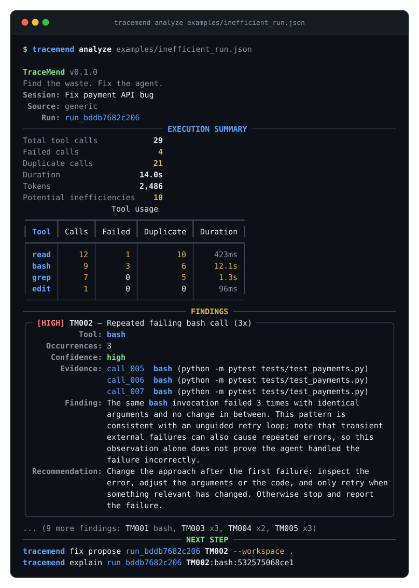
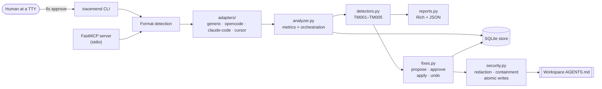

<div align="center">
  
</div>

<div align="center">
  <p><b>Find the waste. Fix the agent.</b><br>
  A linter and safe auto-fixer for AI coding-agent execution traces.</p>
</div>

<div align="center">
  <a href="https://github.com/kartikav05/tracemend/actions/workflows/ci.yml"></a>
  
  
  
  
  
  
</div>

---

TraceMend reads an AI coding agent's execution trace, measures **where the session wasted
work**, and turns that evidence into a small, reviewable patch for your `AGENTS.md` — which
**a human must approve** before a single byte is written to disk.

- 🔒 **No API key.** The analysis core is fully deterministic — no model is required to detect waste.
- 🌐 **No network.** Traces are read from local disk and never uploaded anywhere.
- 🧾 **Evidence-backed.** Every finding cites the exact call ids it is judging, and states what it cannot prove.
- 🤝 **Human-gated.** The MCP server can propose and preview fixes, but it can never authorize one.

TraceMend is deliberately *not* another observability platform — it is not a Langfuse, AgentOps,
Phoenix or Opik replacement. It is one narrow developer loop:

> **Analyze → Diagnose → Propose → Approve → Fix → Compare**

## Contents

- [Why this exists](#why-this-exists)
- [See it run](#see-it-run)
- [Features](#features)
- [Quick start](#quick-start)
- [Connect it to your agent](#connect-it-to-your-agent)
- [How it works](#how-it-works)
- [Documentation](#documentation)
- [Safety model](#safety-model)
- [Project status](#project-status)
- [Contributing](#contributing)

## Why this exists

Coding agents burn time and tokens in ways that are invisible after the fact. A session looks
"fine" in the transcript, but underneath it may contain:

- the same `grep` issued eight times because earlier results were never reused;
- the same failing `bash` command retried three times with identical arguments;
- the same unchanged file read over and over instead of reusing context;
- one tool quietly consuming 87% of the session's wall-clock time.

None of that shows up in a diff, and none of it is attributable. Even when a developer notices
the waste, the fix is guesswork: *which* instruction should change, and did it actually help?

TraceMend closes that loop with evidence. Detection is a deterministic rule over normalized
tool calls, so it is reproducible, explainable and safe to act on. Remediation is deliberately
conservative: an instruction patch to a project-local `AGENTS.md`, stored as a proposal,
diffed, and applied only after an explicit human approval at a terminal.

## See it run



Real output from `examples/inefficient_run.json` (abridged — the run reports 10 findings):

```console
$ tracemend analyze examples/inefficient_run.json

TraceMend v0.1.0
Find the waste. Fix the agent.
Session: Fix payment API bug
 Source: generic
    Run: run_bddb7682c206
────────────────────────────── EXECUTION SUMMARY ───────────────────────────────
Total tool calls            29
Failed calls                 4
Duplicate calls             21
Duration                 14.0s
Tokens                   2,486
Potential inefficiencies    10
─────────────────────────────────── FINDINGS ───────────────────────────────────
╭─ [HIGH] TM002 — Repeated failing bash call (3x) ─────────────────────────────╮
│           Tool: bash                                                         │
│    Occurrences: 3                                                            │
│     Confidence: high                                                         │
│       Evidence: call_005  bash (python -m pytest tests/test_payments.py)     │
│                 call_006  bash (python -m pytest tests/test_payments.py)     │
│                 call_007  bash (python -m pytest tests/test_payments.py)     │
│        Finding: The same bash invocation failed 3 times with identical       │
│                 arguments and no change in between. This pattern is          │
│                 consistent with an unguided retry loop; note that transient  │
│                 external failures can also cause repeated errors, so this    │
│                 observation alone does not prove the agent handled the       │
│                 failure incorrectly.                                         │
│ Recommendation: Change the approach after the first failure: inspect the     │
│                 error, adjust the arguments or the code, and only retry when │
│                 something relevant has changed. Otherwise stop and report    │
│                 the failure.                                                 │
╰──────────────────────────────────────────────────────────────────────────────╯
... (9 more findings: TM001 bash, TM003 x3, TM004 x2, TM005 x3)
────────────────────────────────── NEXT STEP ───────────────────────────────────
tracemend fix propose run_bddb7682c206 TM002 --workspace .
```

The analysis found 10 findings across all five detectors: TM001 `bash` (4x), TM002 `bash`
(3x, high), TM003 `src/payments.py` (4x), `src/config.py` (4x) and `src/payments.py` (3x),
TM004 `payment_status` (5x) and `payment` (2x), plus three informational TM005 hotspots
(`read`, `bash`, `grep`).

## Features

| | Feature | What it gives you |
|:--:|---|---|
| 🔍 | **Deterministic detectors** | Five rule-based passes (TM001–TM005) over normalized calls — no LLM, no sampling, no network. |
| 🧾 | **Evidence-backed findings** | Each finding carries call ids, severity, a confidence level, and an explicit list of what the trace cannot prove. |
| 🧩 | **Trace adapters** | TraceMend generic JSON, OpenCode session exports, and native Claude Code and Cursor imports (planned), with automatic format detection. |
| 🩹 | **Safe auto-fixes** | Deterministic instruction templates for search reuse, retry discipline, file-read reuse and general tool efficiency. |
| 🔐 | **Human-gated remediation** | Proposals, diffs, single-use approvals bound to a patch hash, atomic writes, backups, conflict-safe undo. |
| 📊 | **Run comparison** | Metric-level before/after deltas. Reports behavioural change — never claims causation. |
| 🔌 | **MCP server** | 10 tools, 2 resource templates, 2 prompts over stdio, sharing every service with the CLI. |
| 🗄️ | **Local SQLite state** | Runs, findings, proposals, approvals and patches in one file you can relocate with `TRACEMEND_DATA_DIR`. |
| 🤖 | **Automation-friendly** | `--format json` on every read command, and no interactive prompts in machine-readable modes. |

## Quick start

TraceMend is install-from-source; it is not published to PyPI. Python **3.12+** and
[`uv`](https://docs.astral.sh/uv/) are the only prerequisites.

```bash
git clone https://github.com/kartikav05/tracemend.git
cd tracemend
uv sync --extra dev

uv run tracemend --help
uv run tracemend analyze examples/inefficient_run.json
```

Then walk one finding through the full loop:

```bash
# 1. Analyze and keep the run id the command prints.
uv run tracemend analyze examples/inefficient_run.json

# 2. Turn one finding into a reviewable AGENTS.md patch.
uv run tracemend fix propose <run-id> TM002 --workspace .

# 3. Read the exact diff, then approve it deliberately in your terminal.
uv run tracemend fix diff <proposal-id>
uv run tracemend fix approve <proposal-id>

# 4. Apply it (atomic write + backup), then verify.
uv run tracemend fix apply <proposal-id>

# 5. Roll it back if you change your mind.
uv run tracemend fix undo <patch-id>
```

`fix approve` requires a real TTY and refuses to run without one — that is the point.
Full walkthrough: [`docs/setup.md`](docs/setup.md).

Prefer a container? The repository ships a `Dockerfile` that works with `docker` and `podman`,
including the stdio MCP server — see [`docs/containers.md`](docs/containers.md).

## Connect it to your agent

The MCP server is a thin adapter over the same engine the CLI uses, and it shares the same
local SQLite store:

```bash
uv run tracemend mcp
```

Claude Code:

```bash
claude mcp add tracemend -- uv run --directory /ABS/PATH/TO/trace-mend tracemend mcp
```

Cursor (`~/.cursor/mcp.json`) and OpenCode (`opencode.json`) config blocks, plus the generic
stdio shape, are in [`docs/mcp.md`](docs/mcp.md).

The approval boundary is deliberate: an agent can call `load_trace`, `analyze_trace`,
`get_findings`, `inspect_tool_calls`, `propose_fix` and `preview_fix` freely, but
`apply_approved_fix` only succeeds against an approval a human recorded in a terminal. A
model-generated "approved: true" argument is ignored.

## How it works



Both front ends call the identical `analyzer`, `detectors`, `fixes` and `storage` code, so
they cannot drift apart. The CLI is the **only** path to an approval. Full module map and data
flow: [`docs/architecture.md`](docs/architecture.md).

## Documentation

| Doc | What's in it |
|---|---|
| 📦 [Setup](docs/setup.md) | Clone to first trace, including a copy-paste setup prompt for an agent |
| 🧭 [Detection rules](docs/detection-rules.md) | TM001–TM005: what each proves, and what it explicitly does not |
| 🩹 [Fix workflow](docs/fix-workflow.md) | propose → diff → approve → apply → undo, and the target-file boundary |
| 🔌 [MCP](docs/mcp.md) | Tools, resources, prompts, per-client setup, the approval boundary |
| 🏗️ [Architecture](docs/architecture.md) | Module map, ingestion pipeline and data flow |
| 🔐 [Security and privacy](docs/security.md) | Threat model, path containment, safe writes, retention |
| 🐳 [Containers](docs/containers.md) | Docker/Podman image, state volumes, CI |
| 📈 [Project status](docs/status.md) | Test suite, verified behaviour, limitations, roadmap |
| 🤝 [Contributing](CONTRIBUTING.md) | Dev setup, adding a detector or a trace adapter |

## Safety model

TraceMend reads untrusted input and writes to your repository, so the guardrails are
first-class rather than bolted on:

- **Untrusted trace content.** Trace files are size-limited, treated as data, and never executed; secret-shaped strings are redacted in human-readable reports.
- **Contained writes.** Only a project-local `AGENTS.md` is writable. Paths are resolved and confined to the workspace, with symlink escapes rejected.
- **Atomic and reversible.** Writes go through a temp file and `os.replace`, with a backup; undo refuses to clobber edits made after the patch.
- **Approval is a hash.** An approval is bound to the proposal id, patch hash, workspace, target path and the original file hash, so a modified or stale proposal is rejected.

**Honest limitation:** interactive approval protects against an MCP client *claiming*
authorization. It cannot defend against an agent that already has unrestricted shell access and
impersonates the user. Details: [`docs/security.md`](docs/security.md).

## Project status

v0.1.0 alpha — usable and tested, with an interface that may still change before 1.0.

- ✅ `225 passed, 28 subtests passed` (`uv run pytest`)
- ✅ `uv run ruff check .` clean
- ✅ CLI analyze · compare · fix propose→diff→approve→apply→undo verified end to end
- ✅ MCP tools, resources and prompts verified through the FastMCP test client
- ✅ Container image built and exercised for CLI and stdio MCP

OpenCode is the only shipped concrete adapter; native Claude Code and Cursor imports are
being added. Detection is heuristic and rule-based, and an instruction patch cannot guarantee
an agent will comply. Metrics show behavioural change, not task correctness. See
[`docs/status.md`](docs/status.md) for the honest list.

## Contributing

Contributions are welcome — bug reports, new detectors, new trace adapters, docs and tests.
Start with [`CONTRIBUTING.md`](CONTRIBUTING.md):

```bash
uv sync --extra dev
uv run ruff check .
uv run pytest
```

## License

MIT — see [`LICENSE`](LICENSE).
