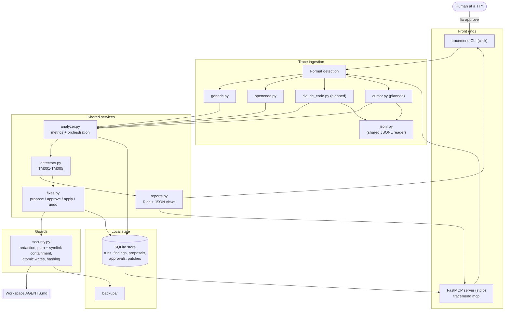
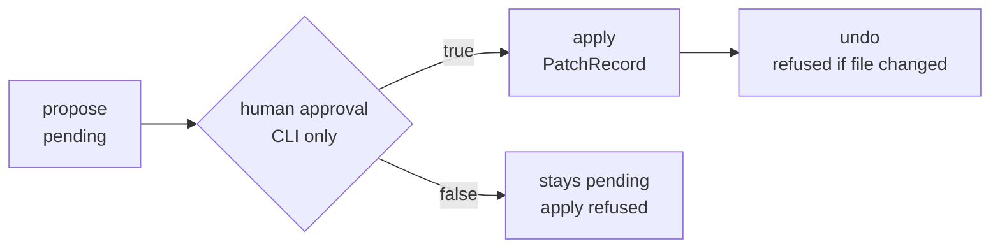

# Architecture

TraceMend is a Python CLI plus a FastMCP stdio server that lint AI agent execution traces and propose safe, human-approved `AGENTS.md` fixes. Both front ends are thin adapters over one deterministic service layer.

[← Back to README](../README.md) · [Detection rules](./detection-rules.md) · [Fix workflow](./fix-workflow.md)

The diagram below is the current source of truth for how the pieces fit together.



Both front ends call the identical `analyzer`, `detectors`, `fixes` and `storage` code.
The CLI is the only path to an approval; the MCP server can propose, preview and apply
already-approved work, but cannot authorize it.

## Module map

The package lives under `src/tracemend/`. Responsibilities below are taken from each
module's own docstring, `__all__` and top-level definitions.

**Entry points**

- `__init__.py` — package metadata; exports `__version__` (`0.1.0`).
- `cli.py` — the `click` command group (`tracemend`), including the `analyze`, `findings`, `finding`, `fix propose|diff|approve|apply|undo|list` and `compare` commands.
- `mcp_server.py` — the FastMCP stdio server exposing the tools (`load_trace`, `analyze_trace`, `get_findings`, `inspect_tool_calls`, `propose_fix`, `preview_fix`, `apply_approved_fix`, `compare_runs`, `undo_fix`, `submit_ai_fix_proposal`), the `tracemend://runs/{run_id}/report` and `tracemend://runs/{run_id}/findings` resource templates, and the `explain_inefficiency` and `optimize_agent` prompts.

**Contracts and errors**

- `models.py` — frozen data contracts shared by the CLI, the MCP server and the services; every other module imports its types from here.
- `errors.py` — the `TraceMendError` hierarchy (`TraceParseError`, `SecurityError`, `ApprovalRequiredError`, `RunNotFoundError`, `FindingNotFoundError`, `ProposalNotFoundError`, `PatchNotFoundError`) carrying an error `code`, an exit code and an optional hint.

**Ingestion**

- `adapters/__init__.py` — the ingestion engine: `detect_format(payload)`, `load_trace_file(path, format=None, *, max_bytes=MAX_TRACE_BYTES)`, `load_trace_text(text, *, format=None, source_path=None)` and `summarise(run, *, skipped=0, redaction_count=0)`. It enforces the size ceiling, hashes the raw bytes, parses JSON and returns a normalized `TraceRun`; invalid JSON raises `TraceParseError`.
- `adapters/generic.py` — the canonical TraceMend JSON trace adapter (`format: "tracemend.generic"`, `version: 1`); applies `security.redact_text`/`redact_value` and accounts for every redaction hit.
- `adapters/opencode.py` — the OpenCode session export adapter, handling the V2 session export, the message/part export and the flat legacy export, and recording removed fields in `run.warnings`.
- `adapters/jsonl.py` — the bounded, line-oriented JSON Lines / NDJSON reader shared by the native adapters (`MAX_JSONL_RECORDS`, `MAX_JSONL_LINE_BYTES`, `looks_like_jsonl`, `parse_jsonl`, `as_rows`, `single_session_id`). A malformed line is a hard error naming the line; blank lines are ignored.
- `adapters/claude_code.py` — (planned) the native Claude Code session JSONL adapter.
- `adapters/cursor.py` — (planned) the native Cursor adapter for CLI `stream-json` NDJSON and already-captured `preToolUse`/`postToolUse` hook JSONL.

**Shared services**

- `analyzer.py` — deterministic metrics, run comparison and report assembly: `compute_metrics(run)`, `compare_runs(before, after)` and `analyze_run(run)`. A metric the trace does not contain is reported as `None`, never as `0`.
- `detectors.py` — the pure, rule-based inefficiency detectors that read one normalized `TraceRun` and return `Finding` records: `detect_duplicate_tool_calls`, `detect_failed_retry_loops`, `detect_repeated_file_reads`, `detect_redundant_searches`, `detect_tool_hotspots`, orchestrated by `run_detectors(run)` and ordered by `sort_findings`; `DETECTOR_CODES = ("TM001", "TM002", "TM003", "TM004", "TM005")`.
- `fixes.py` — the safe auto-fix engine and the main security boundary: `create_proposal`, `diff_for_proposal`, `approve_proposal`, `verify_approval`, `apply_proposal` and `undo_patch`. It renders exactly one idempotent managed section inside an `AGENTS.md` and never writes to disk without a patch-bound human approval.
- `reports.py` — the presentation layer shared by the CLI and the MCP resource endpoints: Rich builders plus JSON payload helpers, with every human-readable string passed through `security.redact_text`.
- `storage.py` — SQLite persistence built on the standard library only, exposing the `Store` class.
- `security.py` — safety primitives: `redact_text`, `redact_value`, `limit_preview`, `validate_instruction_text`, the `sha256_*` helpers, `read_text_limited`, `resolve_workspace`, `is_within`, `validate_target_file`, `resolve_target_path`, `atomic_write_text`, `make_backup` and `ensure_within_workspace`.

## Pipeline

The lifecycle of a trace is a single deterministic pipeline that both front ends drive through the same functions.

1. **Ingest** — `adapters.load_trace_file` (or `load_trace_text`) reads the file through `security.read_text_limited`, hashing the raw bytes and enforcing the size ceiling.
2. **Normalize** — `adapters.detect_format` chooses the `generic`, `opencode`, `claude-code` or `cursor` adapter; the adapter redacts secrets and shapes the payload into a normalized `TraceRun` with deterministic `run_id` values, unique event ids and a post-sort `sequence`.
3. **Detect** — `analyzer.analyze_run` calls `detectors.run_detectors(run)` to produce `Finding` records and `compute_metrics(run)` to produce `RunMetrics`, then assembles an `AnalysisReport`.
4. **Report** — `reports.py` renders that report for a terminal (Rich) or as JSON. `analyzer.compare_runs` supports the before/after comparison view.
5. **Propose** — `fixes.create_proposal(store, ...)` is a pure database operation: it records a `pending` `FixProposal` and never touches the file. `fixes.diff_for_proposal` renders the preview.
6. **Approve** — `fixes.approve_proposal(store, proposal_id, confirm=...)` stores an `ApprovalRecord` bound to the proposal's `patch_sha256`, `workspace`, `target_file` and `original_sha256`. This path exists only in the CLI.
7. **Apply** — `fixes.apply_proposal(store, proposal_id)` verifies the stored approval with `fixes.verify_approval` and then writes through `security` (path/symlink containment, backup, atomic write), recording a `PatchRecord`.
8. **Undo** — `fixes.undo_patch(store, patch_id)` reverts TraceMend's own patch and refuses to clobber unrelated edits made afterwards.



An approval recorded in SQLite by `tracemend fix approve` is visible to the MCP server, which is why `apply_approved_fix` can act on the exact proposal a human authorized. A model-supplied boolean can never satisfy `apply_proposal`.

## Front ends share one service layer

Neither front end reimplements the engine. The CLI imports the shared modules directly (`src/tracemend/cli.py:17-22`):

```python
from . import __version__, fixes, reports
from .adapters import load_trace_file
from .analyzer import analyze_run
from .errors import ApprovalRequiredError, TraceMendError
from .models import AnalysisReport, TraceRun
from .storage import Store
```

The MCP server imports the same application modules (`src/tracemend/mcp_server.py:31-40`):

```python
from . import adapters, analyzer, fixes
from .errors import ApprovalRequiredError, TraceMendError
from .reports import (
    ...
)
from .security import limit_preview, redact_text, redact_value
from .storage import Store
```

Concretely, `cli.py` calls `load_trace_file` → `Store.save_run` → `analyze_run` → `Store.save_report` (`src/tracemend/cli.py:57-60`), and `mcp_server.py` calls the same `adapters.load_trace_file`, `analyzer.analyze_run`, `fixes.create_proposal`, `fixes.apply_proposal` and `fixes.undo_patch`. The asymmetry is deliberate: `fixes.approve_proposal` appears only in `cli.py`, so authorization stays on the interactive terminal.

## Local state

`storage.py` opens one SQLite database (default filename `tracemend.sqlite3`, override the directory with the `TRACEMEND_DATA_DIR` environment variable) and creates the schema at `SCHEMA_VERSION = 1`. Only derived, minimized data is stored; raw transcripts are never retained beyond the normalized events. The tables are:

- `meta` — key/value metadata, holding `schema_version`.
- `runs` — `run_id` (primary key), `session_id`, `source`, `title`, `imported_at`, `payload`.
- `reports` — `run_id` (primary key), `generated_at`, `payload`.
- `findings` — composite primary key `(run_id, finding_id)`, plus `code`, `severity`, `confidence`, `tool`, `occurrences` and `payload`, with indexes on `run_id` and `(run_id, severity)`.
- `proposals` — `proposal_id` (primary key), `run_id`, `finding_id`, `strategy`, `target_file`, `workspace`, `status`, `created_at`, `payload`.
- `approvals` — `approval_id` (primary key), `proposal_id` (`UNIQUE`), `approved_at`, `payload`.
- `patches` — `patch_id` (primary key), `proposal_id`, `run_id`, `status`, `applied_at`, `payload`.

Backups written by `security.make_backup` live in the `backups/` directory rather than in the database.

## Related

- [Setup](./setup.md)
- [MCP](./mcp.md)
- [Fix workflow](./fix-workflow.md)
- [Security](./security.md)
- [Status](./status.md)
- [Back to README](../README.md)
